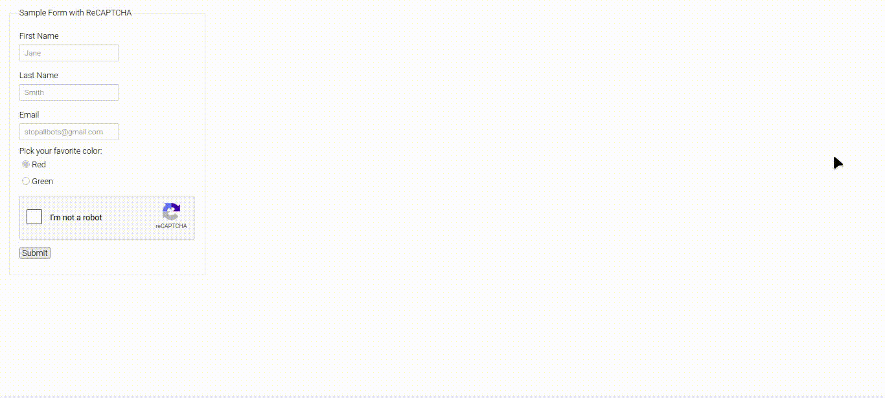

# Natural Pointer Move Bot

**Watch the demo:** 

This bot moves the mouse so smoothly and naturally that even Google reCAPTCHA accepts it.

A small desktop tool that moves the mouse cursor along human-like curves instead of jumping straight to the target. You select a window on screen, click where the cursor should go, choose a click action, and the bot handles the rest. Repetition, delays, pause and stop are all included.

---

## What it does

1. A short countdown appears so you can get ready.
2. The screen is captured and shown fullscreen. You drag a rectangle around the window you want to work with.
3. A cropped preview of that window opens. You click the exact destination.
4. You pick the click type: none, left, right, middle, or double left.
5. The cursor glides to the target along a natural curve and clicks.
6. If you want, it can repeat the movement a number of times, each starting from a random point inside the window, with an optional pause between runs.

---

## Features

- Visual window selection by drawing a rectangle on a screenshot
- Destination picked directly from the window preview
- Five click options: none, left, right, middle, double left
- Cubic Bézier motion with randomized control points and smoothstep easing
- Repetition mode starting from random points inside the window
- Optional delay between repetitions (0 to 3600 seconds)
- Pause, resume, and stop with F8, F9, and ESC
- PyAutoGUI fail-safe enabled by default

---

## Requirements

- Python 3.9 or newer
- A desktop environment (Windows, macOS, or Linux with a display server)

## Installation

```bash
git clone https://github.com/ILookLikeShadow/NaturalPointerMoveBot.git
cd NaturalPointerMoveBot
pip install pyautogui pillow

Run
bash

python natural_pointer_move_bot.py
```

On some Linux setups you may also need python3-tk and scrot or gnome-screenshot for ImageGrab.
Hotkeys
Key	Action
F8	Pause or resume
F9	Stop
ESC	Cancel or stop
How the motion works

Rather than calling moveTo in a straight line, the cursor follows a cubic Bézier curve. Two control points are placed along the path with random offsets that scale with distance. The t parameter is eased with smoothstep, t²(3 − 2t), so the motion accelerates and decelerates naturally. Step count and total duration scale with distance, roughly distance / 650 seconds with sensible limits. A short final moveTo lands exactly on the target before the click.

The result is that no two movements look the same, which is what a real hand does.
Configuration

A few values at the top of the script are easy to adjust:
Variable	Purpose	Default
self.start_delay	Seconds before the window selection screen appears	5
repeat_delay	Pause between repetitions, set from the UI	0.0
Bézier offset	Amount of natural wobble in move_naturally	min(110, distance * 0.18)
Duration clamp	Speed limits for a single movement	0.4 to 2.5 seconds
Safety notes

    PyAutoGUI's fail-safe is enabled. Move the mouse into a screen corner to abort.

    The bot never starts on its own. It always waits for you to press START.

    Every action can be cancelled with ESC, F9, or by closing the control window.

    Use it responsibly. Automating clicks on third-party services may violate their terms.

Project layout
text

NaturalPointerMoveBot/
├── natural_pointer_move_bot.py
├── examvids/
│   └── exam1.gif
├── README.md
└── LICENSE

Contributing

Pull requests are welcome. For larger changes, please open an issue first to talk about what you want to change.

    Fork the repository

    Create a branch: git checkout -b feature/my-feature

    Commit your changes: git commit -m "Add my feature"

    Push the branch: git push origin feature/my-feature

    Open a pull request

License

Released under the MIT License. See the LICENSE file for details.
Disclaimer

This software is provided for educational and personal automation purposes. The author is not responsible for any misuse, including violations of third-party terms of service. Use at your own risk.
